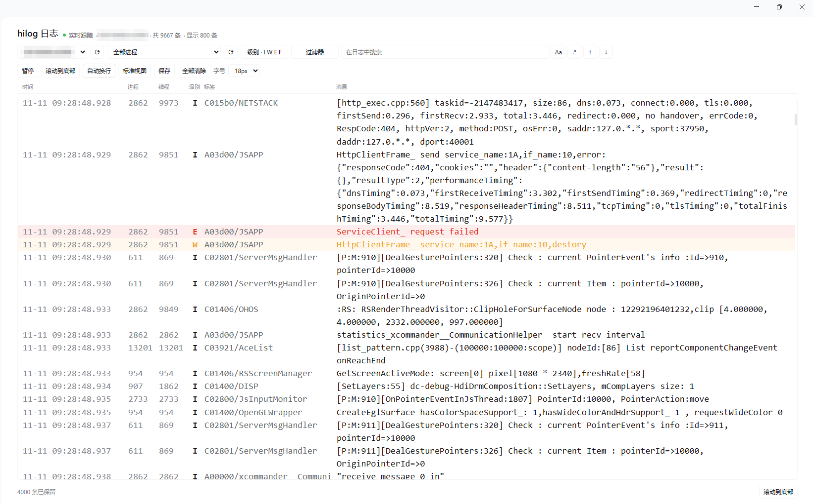

# dsh-harmony

[](https://github.com/mobius-2046/dsh-harmonyos-agent/releases)
[](LICENSE)
[](#边界)
[](#十五个动作)

把「改 ArkTS → 等编译 → 装真机 → 翻 hilog → 再改」这条循环，变成一句话交代：agent 自己跑完，并把证据（编译结论、安装结果、启动画面、日志）摆回你面前。

<p align="center">
  
</p>

## 这东西给谁用

写给正在做鸿蒙应用、并且**已经在用 DevEco Studio 把工程跑起来**的人：

- 工程在本地，`hvigorw`、`hdc`、签名配置都能用；真机或模拟器插着。
- 每天的动作是重复的：改几行 ArkTS、等两分钟编译、装到手机、点开、看 hilog 里那条报错。
- 你想用自然语言把这串动作交代出去，而不是亲手点十六下；出错时希望它先读第一条错误再改，而不是盲改。

不是给这些场景的：只想点预览器看效果、不做真机调试的人；没有 `hdc` 设备的人；期待它替代 DevEco 的断点调试、内存分析、UI 预览器的人——那些我没做，也不假装能做。

## 你现在这样干，装上之后

| 现在 | 装上之后 | 省掉什么 |
|---|---|---|
| 改完代码，切到 DevEco，点构建，等进度条 | 一句「改完跑一下真机」，agent `compile` 先做类型检查、再 `run` 构建装机 | 切窗口、盯进度条 |
| 装完手动点开应用，看有没有崩 | `run` 一次做完：装包、补 HSP、拉起、抓 6 秒日志 | 三次点击 + 一次等待 |
| 日志窗口里按进程名筛，滚很久找那条 FATAL | `logs` 给包名就只留这个进程的行；`crash` 直接读最新崩溃日志并解出栈顶帧 | 手筛、翻文件 |
| 报错看不懂：`9568305`、`EBUSY`、签名不过 | 错误码表给处置建议，失败后一行「接下来做什么」 | 搜论坛、反复试 |
| 改完不确定界面对不对 | `screenshot` 截图、`ui op=assert` 断言文字/个数/指纹 | 肉眼比对 |
| 想确认某接口从哪个版本开始有 | `docs op=api` 查本地 SDK 的 `@since` | 翻官网、等加载 |

## 一分钟上手

前置：Windows、dsh `>=0.2.1-rc.5`、DevEco Studio 6.x（提供 `hvigorw` 和 `hdc`）、设备已连上 `hdc list targets`。

```powershell
# 1. 安装（插件页选目录，或命令行）
dsh plugin --profile desktop add file:<本目录>

# 2. 重启一次 Harness（浏览器半边与日志面板要重新加载）

# 3. 新建会话，预设选择器里选 HarmonyOS
```


然后第一句话可以是：

```
/plan 给这个工程加一个设置页，带深色模式开关
```

它只读调研、给方案和验证命令；你批准（或 `/build`）后进 build，改完代码自己构建、装机、拉日志。

## 它提供什么

| 部件 | 内容 |
|---|---|
| 预设 `harmony` | 与官方 `standard` 同源的编码工具面，人格换成鸿蒙专家；运行时注册，不占用官方预设位 |
| 命令 | `/build`（plan 停在半路时直接开工）、`/mode`（看当前 plan / goal 状态）、`/goal`（要求写清完成判据与验证方式）；`/plan` 是宿主内置 |
| 技能 | `harmony-project`、`harmony-arkts`、`harmony-build-deploy`、`harmony-ohpm` |
| 工具 | 一个 `harmony`，十五个动作，见下表 |
| 日志面板 | 侧边栏 **hilog** 图标 → 全屏日志页：设备切换、级别/进程/关键字过滤、实时跟随、快照与对比 |
| 设备徽标 | 侧边栏左下角的小手机图标：绿色胶囊=在线台数；点开看每台的机型、序列号、API、电量、温度、内存与存储 |

三个模式不是三个 agent，而是同一个会话的三种状态：

| 模式 | 进入方式 | 行为 |
|---|---|---|
| plan | `/plan` | 只读调研，产出方案，`exit_plan_mode` 提交审批；工具层面拒绝构建/装机 |
| goal | `/goal <目标>；完成判据：<可观察结果>；验证方式：<命令>` | 持久目标 + 自动续跑；缺判据或验证方式会被拒绝，避免「一轮轮继续」 |
| build | 关闭 plan 后的默认状态 | 直接改文件并构建验证 |

## 十五个动作

| action | 做的事 |
|---|---|
| `build` | `hvigorw assembleHap`（`hsp: true` 时再跑 `assembleHsp`），返回产物、是否已签名、结构化错误 |
| `compile` | 只做 ArkTS 类型检查，约是完整构建的一半时间 |
| `deps` | `ohpm install --all`：改了 `oh-package.json5` 之后同步依赖 |
| `run` | build → 装包 →（HSP）补依赖 → `aa start` → 抓日志，五段结论；`matrix` 可按设备分工；plan 模式下拒绝 |
| `devices` | 列出设备与机型、API、电量、温度、内存、存储 |
| `deploy` | 装指定 `.hap`，可选拉起；支持多设备 |
| `logs` | 限时抓 `hilog`；给 `bundleName` 就按 pid 只留这个应用；`filter` 用子串或 `/regex/flags` |
| `screenshot` | 抓设备截图到本地，返回路径与分辨率 |
| `app` | `op=start/stop/clear/uninstall` 启停、清数据、卸载；`op=query` 查装没装、什么版本（只读） |
| `doctor` | 一次查完 hdc / 设备 / SDK / hvigorw / 签名 / shared 产物 / ohpm；`fix: true` 时顺手修三类验得出的问题 |
| `sign` | 构建前核对签名材料、证书有效期、products 引用 |
| `ui` | `dump` 读控件树；`find` 只查不点；`wait` 等文字出现/消失；`assert` 断言界面（文字、个数、指纹），`device=all` 逐台跑出一张表；`tap`/`input`/`key`/`swipe` 操作 |
| `file` | `op=pull` 拉回设备文件、`op=send` 推到设备 |
| `crash` | 读最新 jscrash / cppcrash / appfreeze，解出进程、原因、栈顶帧 |
| `docs` | 离线文档：`config` 配目录、`search` 查关键词、`read` 读原文、`api` 查接口的 `@since` |

多台设备有两种写法：`device="all"` 或 `device="a,b"` 设备列表；每台要做不同的事就用 `matrix`：

```
matrix: "009180680c438f8f=install;03516892320539=run"
```

`run` 只编译一次；结果是一张「设备 × 动作 × 结果」的表，没启动的行写 `—` 而不是 `0`。写法错（动作拼错、同一台写两次、id 不在线）在编译**之前**返回。

## 看日志与查文档

点侧边栏 **hilog**：选设备 → 灌入最近 120 行 → 实时追加。按级别、进程、关键字过滤都在浏览器里完成，不重连。

复现问题前点 **快照** 存基准，修完再存一份，点 **对比**：按行出现次数报「新增 / 消失 / 相同」。快照可以改名、导出 `.log`、单条删除，名字与内容存在浏览器本地。

查接口先配一次文档目录（离线，不联网）：

```text
harmony  action=docs  op=config  dir=D:\docs-openharmony-6.1-release\zh-cn\application-dev
harmony  action=docs  op=config  sdk=D:\SDK\Openharmony-6.0\20\ets\api
```

之后 `docs op=search` / `op=read` / `op=api`。搜索有硬预算（4000 文件 / 64 MB / 10 秒），停下时说清扫了多少、为什么停——「没扫完」不会说成「没有」。

## 边界

- 只支持 Windows（启用 `tool-pwsh`、关闭 `tool-bash`）。
- 工程目录必须可写：hvigor 要写 `<project>/.hvigor` 与 `build/`。
- 未配置签名只会产出 unsigned，真机装不上；本工具只核对签名，不做签名（`hap-sign-tool` 需要明文密码，交给你决定放哪）。
- `run` 的「日志为空」是正常结果，不等于「没有崩溃」。
- 同一工程同时只允许本工具发一个构建（第二个会被锁挡回）；DevEco Studio 自己的构建只能靠 `EBUSY` 发现。

## 发版记录

| 版本 | 主要变化 |
|---|---|
| 0.31.1 | 修：两台设备的 `matrix` 被误判成「设备没连接」 |
| 0.31.0 | `ui op=assert` 支持 `device=all`，结果为「N/M 台符合预期」+ 每台一行 |
| 0.30.0 | `run` 支持 `matrix`：一条调用里按设备分工，结果是一张表 |
| 0.29.0 | `app op=query` 查安装状态与版本 |
| 0.28.0 | 快照可改名、导出 `.log`、单条删除 |
| 0.27.0 | `ui op=assert` 断言界面：文字、个数、指纹 |
| 0.26.0 | `doctor fix: true` 修残留构建锁、缺 pnpm wrapper、缺 HSP 产物 |
| 0.25.0 | `run` 失败按首错归类，给「接下来做什么」 |
| 0.24.0 | 同一工程同时只跑一个构建 |
| 0.23.0 | `ui op=wait` 等文字出现或消失 |
| 0.22.0 | `sign` 核对签名配置与证书有效期 |
| 0.21.1 | 设备徽标标出「上次使用」并可切换 |
| 0.21.0 | `doctor` 每项探测限时，超时与「没来得及跑」分开报 |
| 0.20.0 | 离线文档：`docs` 的 config / search / read / api |
| 0.19.0 | 错误码处置建议、记住上次设备、`ui op=find` |
| 0.7.0–0.18.0 | 多设备、plan 守卫、HSP 分层安装、快照对比、截图、`app`、`doctor`、`ui`、`logs` 过滤、`file`、`compile`、`crash`、`/goal`、`deps`、日志按 pid |

完整动机与细节见 [CHANGELOG.md](CHANGELOG.md)，安装包见 [Releases](https://github.com/mobius-2046/dsh-harmonyos-agent/releases)。

## 更多

- [docs/design-notes.md](docs/design-notes.md)：给维护者——踩过的坑、改代码何时要重启、工具 schema 陷阱、为什么预设是运行时注册的。
- [docs/roadmap.md](docs/roadmap.md)：接下来做什么、以及不做什么。
- [LICENSE](LICENSE)：MIT。
