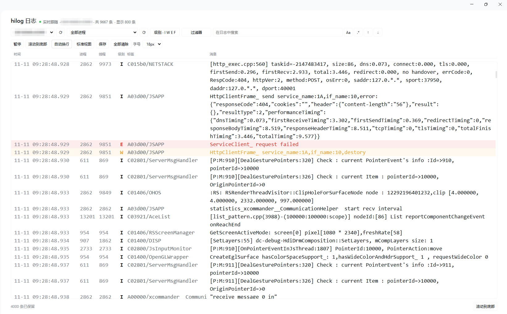
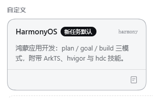

# dsh-harmony

让 DeepSeek Harness 变成一个会写鸿蒙应用的 agent：**plan 先想清楚，goal 盯到底，build 落到真机**。

<p align="center">
  
</p>

## 它能做什么

- 你说「给这个工程加一个设置页」，它读工程结构、改 ArkTS、跑 hvigor、装到真机、拉日志确认；编译报错时先读第一条错误再改，而不是盲改。
- `/plan` 让它先只读调研、出方案，你批准后才动手。
- `/goal 让设置页在真机上打开并截图` 给它一个跨轮目标，它自己一轮轮推进，输入区上方的 GoalBar 显示进度。
- 侧边栏的 **hilog** 面板按 DevEco Studio 的 HiLog 窗口做：选设备、按进程 / 级别 / 关键字过滤，实时跟随，可暂停、保存。

## 它提供什么

| 部件 | 内容 |
|---|---|
| 预设 `harmony` | 与 `standard` 同源的编码工具面（26 个组件），人格换成鸿蒙专家，内置 plan / goal / build 三模式所需件；运行时注册，不占用官方预设位 |
| 命令 | `/build`（plan 停在半路时直接开工）、`/mode`（看当前 plan / goal 状态）、`/goal`（要求写清完成判据与验证方式）；`/plan` 是宿主内置 |
| 技能 | `harmony-project`、`harmony-arkts`、`harmony-build-deploy`、`harmony-ohpm` |
| 工具 | 一个 `harmony`，十三个动作：`build` / `compile` / `deps` / `run` / `devices` / `deploy` / `logs` / `screenshot` / `app` / `doctor` / `ui` / `file` / `crash` |
| 日志面板 | 侧边栏 **hilog** 图标 → 全屏日志页 |
| 设备徽标 | 侧边栏左下角的小手机图标：绿色胶囊=在线台数；点开是每台的机型、序列号、API、电量、温度、内存与存储占用 |

三个模式不是三个 agent，而是同一个会话的三种状态：

| 模式 | 进入方式 | 行为 |
|---|---|---|
| plan | `/plan` | 只读调研，产出方案，`exit_plan_mode` 提交审批 |
| goal | `/goal <目标>；完成判据：<可观察结果>；验证方式：<命令>` | 持久目标 + 自动续跑；缺判据或验证方式会被拒绝 |
| build | 关闭 plan 后的默认状态 | 直接改文件并构建验证 |

## 开发思路

**复用宿主，不重造 agent。** plan 与 goal 是宿主自带的 `planMode`、`goals` 服务，本包只补人格、命令出口和领域技能；三个模式共享一个会话上下文，切换不丢历史。

**工具面越小越好。** 只注册一个 `harmony`，用 `action` 选动作。每个工具的 schema 每轮都要重发，四个工具加上同时并存的 DevEco CLI 工具曾把工具表撑到 87 个、近一成上下文；合并成一个是最直接的优化。

**一次调用走完闭环。** `run` = 构建 → 装 entry →（HSP 工程）补装依赖 → 拉起 Ability → 抓 6 秒日志，返回五段结论。这四步如果让模型自己串，平均多花 3–4 轮。

**预设运行时注册。** Loader 行只能按 profile 的 `node_modules` 解析包名，而 profile 缺 73 个 `@deepseek-ai/*` 依赖；本包改用 `agentPresets.register()`，让子插件按宿主自带的 app.asar 解析。原因和失败现场见 [docs/design-notes.md](docs/design-notes.md)。

**面板走已有的登录通道。** 浏览器拿不到 `hdc`，所以 `client.js` 只画界面，采集在 Host 侧；三条 `/api/harmony/logs*` 路由挂在宿主的 `ctx.connection.fetch` 上（带浏览器令牌，不是公开端口），用 NDJSON 流推日志。

## 如何安装

前置：dsh `>=0.2.1-rc.5 <0.3.0-0`、Windows + PowerShell、DevEco Studio 6.x（提供 `hvigorw` / `hdc`）。真机调试需要设备已连上 `hdc`。

插件页点「安装」选本目录，或在 `plugin_manager` 里：

```
install_bundle  target: <本目录的绝对路径>
```

```powershell
# 或用 CLI
dsh plugin --profile desktop add file:<本目录>
```

装完新建会话，在预设选择器里选 **HarmonyOS**。



第一次安装（或升级到带新 `client.js`、新 Host 路由的版本）后需要**重启一次 Harness**，浏览器半边和日志面板才会加载。

## 如何使用

**1. 先规划，再动手**

```
/plan 给这个工程加一个设置页，带深色模式开关
```

它只读探索、给出方案与验证命令，你批准（或输入 `/build`）后进入 build。

**2. 给一个能验收的目标**

```
/goal 让设置页在真机上能打开并截图；完成判据：真机截图里能看到开关；验证方式：harmony run 后 hilog 无 FATAL
```

GoalBar 显示状态；目标达成或明确失败时它会停下来。


**3. 构建与真机验证**

| action | 做的事 |
|---|---|
| `build` | `hvigorw assembleHap`（`hsp: true` 时再跑 `assembleHsp`），返回产物、是否已签名、结构化错误 |
| `run` | build → 装包 →（HSP）补依赖 → `aa start` → 抓日志，五段结论；plan 模式下拒绝执行 |
| `devices` | 列出 `hdc` 设备 |
| `deploy` | 装指定 `.hap`，可选拉起；支持多设备 |
| `logs` | 限时抓取 `hdc shell hilog`；给 `bundleName` 就解析 pid 只留这个应用的日志；支持多设备合并；`filter` 用子串或 `/regex/flags` |
| `screenshot` | 抓一张设备截图存到本地临时目录，返回文件路径与分辨率 |
| `app` | `op=start/stop/clear/uninstall` 启停应用、清数据、卸载 |
| `doctor` | 一次查完 hdc / 设备 / SDK / hvigorw / 签名 / shared 产物 / ohpm，坏在哪一项直接说 |
| `ui` | `op=dump` 读界面控件树；`tap` 按文字点、`input` 输入、`key` 按键、`swipe` 滑动 |
| `file` | `op=pull` 把设备文件拉回本机、`op=send` 把本机文件推到设备 |
| `crash` | 读设备上最新的崩溃日志（jscrash / cppcrash / appfreeze），可按包名筛选，提取进程、原因与栈顶帧 |
| `deps` | `ohpm install --all`：改了 oh-package.json5 之后同步依赖，registry 或本地 .har 的问题当场说清 |

**4. 看真机日志**

点侧边栏 **hilog**：选设备 → 先灌入最近 120 行 → 实时追加。按级别（默认关掉 Debug）、进程、关键字过滤都在浏览器里完成，不重连。

复现问题前点 **快照** 存一份基准，修完再存一份，点 **对比** 选两份快照：按行出现次数报「新增 / 消失 / 相同」，一眼看出那条报错是否真的不再出现。

**5. 多台设备一起**

`deploy`、`run`、`logs` 的 `device` 传 `all` 走所有已连接设备，或传 `a,b` 指定几台。`run` 只编译一次，安装与启动按设备并行；一台失败不影响其余，结论按设备分块列出。

**6. 看一眼界面、关掉应用**

`screenshot` 把当前画面存成 JPEG 并返回路径（可以多台一起抓），比让模型猜 UI 靠得住；`app` 用 `op=stop` 强停、`op=clear` 清数据、`op=uninstall` 卸载，验证「冷启动是否还会崩」时不用手点设备。

需要读写设备上的文件时用 `file`：`op=pull` 默认落到临时目录并返回字节数，`op=send` 需要显式 `local`；设备路径一律写绝对路径（`/data/local/tmp/…`）。

要操作界面就再加一步 `ui`：`op=dump` 把控件树拍平成「类型 + 文字 + 是否可点 + 坐标」，`op=tap` 直接按文字点击（`text: "登录"`），`op=input` 往焦点或指定坐标输入，`op=key` 发 Back/Home，`op=swipe` 翻列表。截图负责「看见」，`ui` 负责「点到」，两者合起来才是完整的界面回归。

**7. 构建失败前先体检**

感觉「环境不对」时先跑 `doctor`，它把 hdc、设备、SDK、hvigorw、签名、shared 模块产物、ohpm 逐项标成 ✓ / ! / ✗，并说明每一项各自的处置；比从一条 hvigor 报错往回猜快。

**边界**：只支持 Windows（`tool-pwsh` 启用、`tool-bash` 关闭）；工程目录必须可写（hvigor 要写 `<project>/.hvigor` 和 `build/`）；未配置签名只会产出 unsigned，真机装不上；`run` 的「日志为空」是正常结果，不等于「没有崩溃」。

## 发版记录

| 版本 | 主要变化 |
|---|---|
| 0.18.0 | 设备徽标修好样式（此前只在日志面板里挂载 CSS），并展示机型、电量、温度、内存、存储 |
| 0.17.0 | 左下角设备徽标：在线状态、台数、点开看序列号（不必打开面板或跑 `devices`） |
| 0.16.0 | `logs` 按 pid 收敛：给包名就只看这个应用的行（栈帧跟着上一条记录保留） |
| 0.15.0 | `deps`：`ohpm install --all`，把依赖问题从「构建时报找不到模块」提前到安装时 |
| 0.12.0 | `compile`：只做 ArkTS 类型检查，约是完整构建的一半时间 |
| 0.11.0 | `file`：在设备和本机之间收发文件，plan 下只允许 pull |
| 0.10.x | `ui`：读控件树、按文字点击、输入、按键、滑动；`logs` 支持关键字与正则过滤 |
| 0.9.0 | `doctor`：一次检查工程、hdc、设备、SDK、hvigorw、签名、shared 产物、ohpm |
| 0.8.0 | `screenshot` 抓真机屏幕；`app` 启停/清数据/卸载 |
| 0.7.0 | 多设备并行（`device=all` / 列表）；plan 模式下工具拒绝构建安装；HSP 依赖按层安装；hilog 快照与对比 |
| 0.6.5 | 修好预设挂载（`agentPresets` 必须进 `export const inject`）、`/build` `/mode` 中文化、补文档与截图 |
| 0.6.1 | 预设改为运行时注册，不再覆盖 `preset-minimal`；三模式补显式入口 |
| 0.5.0 | 四工具合并为 `harmony`；新增端到端 `run`；HSP 工程可装；签名状态可见 |
| 0.4.1 | 补齐 plan-mode 的 `section`，删掉不存在的 `list-agents` 子路径 |
| 0.4.0 | 预设改为覆盖官方行（0.6.1 起被运行时注册取代） |
| 0.3.x | 沙箱内可构建（`HVIGOR_USER_HOME` 隔离）、hilog 面板、修 HTTP 500 |

每个版本的动机和细节见 [CHANGELOG.md](CHANGELOG.md)，发布包见 [Releases](https://github.com/mobius-2046/dsh-harmonyos-agent/releases)。

## 更多

- [docs/design-notes.md](docs/design-notes.md)：给维护者——9 个踩过的坑、改代码何时要重启、工具 schema 陷阱。
- [LICENSE](LICENSE)：MIT。
