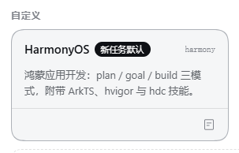

# dsh-harmony

[](https://github.com/mobius-2046/dsh-harmonyos-agent/releases)
[](LICENSE)
[](#边界)
[](#十五个动作)

把「改 ArkTS → 等编译 → 装真机 → 翻 hilog → 再改」这条循环，变成一句话交代：agent 自己跑完，并把证据（编译结论、安装结果、启动画面、日志）摆回你面前。

<p align="center">
  
</p>

## 这东西给谁用

写给正在做鸿蒙应用、并且**已经在用 DevEco Studio 把工程跑起来**的人：

- 工程在本地，`hvigorw`、`hdc`、签名配置都能用；真机或模拟器插着。
- 每天的动作是重复的：改几行 ArkTS、等两分钟编译、装到手机、点开、看 hilog 里那条报错。
- 你想用自然语言把这串动作交代出去，而不是亲手点十六下；出错时希望它先读第一条错误再改，而不是盲改。

不是给这些场景的：只想点预览器看效果、不做真机调试的人；没有 `hdc` 设备的人；期待它替代 DevEco 的断点调试、内存分析、UI 预览器的人——那些我没做，也不假装能做。

## 你现在这样干，装上之后

| 现在 | 装上之后 | 省掉什么 |
|---|---|---|
| 改完代码，切到 DevEco，点构建，等进度条 | 一句「改完跑一下真机」，agent `compile` 先做类型检查、再 `run` 构建装机 | 切窗口、盯进度条 |
| 装完手动点开应用，看有没有崩 | `run` 一次做完：装包、补 HSP、拉起、抓 6 秒日志 | 三次点击 + 一次等待 |
| 日志窗口里按进程名筛，滚很久找那条 FATAL | `logs` 给包名就只留这个进程的行；`crash` 直接读最新崩溃日志并解出栈顶帧 | 手筛、翻文件 |
| 报错看不懂：`9568305`、`EBUSY`、签名不过 | 错误码表给处置建议，失败后一行「接下来做什么」 | 搜论坛、反复试 |
| 改完不确定界面对不对 | `screenshot` 截图、`ui op=assert` 断言文字/个数/指纹 | 肉眼比对 |
| 想确认某接口从哪个版本开始有 | `docs op=api` 查本地 SDK 的 `@since` | 翻官网、等加载 |

## 一分钟上手

前置：Windows、dsh `>=0.2.1-rc.5`、DevEco Studio 6.x（提供 `hvigorw` 和 `hdc`）、设备已连上 `hdc list targets`。

```powershell
# 1. 安装（插件页选目录，或命令行）
dsh plugin --profile desktop add file:<本目录>

# 2. 重启一次 Harness（浏览器半边与日志面板要重新加载）

# 3. 新建会话，预设选择器里选 HarmonyOS
```



然后第一句话可以是：

```
/plan 给这个工程加一个设置页，带深色模式开关
```

它只读调研、给方案和验证命令；你批准（或 `/build`）后进 build，改完代码自己构建、装机、拉日志。

## 它提供什么

| 部件 | 内容 |
|---|---|
| 预设 `harmony` | 与官方 `standard` 同源的编码工具面，人格换成鸿蒙专家；运行时注册，不占用官方预设位 |
| 命令 | `/build`（plan 停在半路时直接开工）、`/mode`（看当前 plan / goal 状态）、`/goal`（要求写清完成判据与验证方式）；`/plan` 是宿主内置 |
| 技能 | `harmony-project`、`harmony-arkts`、`harmony-build-deploy`、`harmony-ohpm` |
| 工具 | 一个 `harmony`，十五个动作，见下表 |
| 日志面板 | 侧边栏 **hilog** 图标 → 全屏日志页：设备切换、级别/进程/关键字过滤、实时跟随、快照与对比 |
| 设备徽标 | 侧边栏左下角的小手机图标：绿色胶囊=在线台数；点开看每台的机型、序列号、API、电量、温度、内存与存储 |

三个模式不是三个 agent，而是同一个会话的三种状态：

| 模式 | 进入方式 | 行为 |
|---|---|---|
| plan | `/plan` | 只读调研，产出方案，`exit_plan_mode` 提交审批；工具层面拒绝构建/装机 |
| goal | `/goal <目标>；完成判据：<可观察结果>；验证方式：<命令>` | 持久目标 + 自动续跑；缺判据或验证方式会被拒绝，避免「一轮轮继续」 |
| build | 关闭 plan 后的默认状态 | 直接改文件并构建验证 |

## 十七个动作（`docs` 多一个 `compat` 子操作）

| action | 做的事 |
|---|---|
| `build` | `hvigorw assembleHap`（`hsp: true` 时再跑 `assembleHsp`），返回产物、是否已签名、结构化错误 |
| `compile` | 只做 ArkTS 类型检查，约是完整构建的一半时间 |
| `deps` | `ohpm install --all`：改了 `oh-package.json5` 之后同步依赖 |
| `run` | build → 装包 →（HSP）补依赖 → `aa start` → 抓日志，五段结论；缺 shared 产物时自动补建一次；`matrix` 可按设备分工；plan 模式下拒绝 |
| `devices` | 列出设备与机型、API、电量、温度、内存、存储 |
| `deploy` | 装指定 `.hap`，可选拉起；支持多设备 |
| `logs` | 限时抓 `hilog`；给 `bundleName` 就按 pid 只留这个应用；`filter` 用子串或 `/regex/flags`；默认返回摘要（级别计数、重复折叠、错误列表），`view: "raw"` 看原文 |
| `screenshot` | 抓设备截图到本地，返回路径与分辨率 |
| `app` | `op=start/stop/clear/uninstall` 启停、清数据、卸载；`op=query` 查装没装、什么版本（只读） |
| `doctor` | 一次查完 hdc / 设备 / SDK / hvigorw / 签名 / shared 产物 / ohpm；`fix: true` 时顺手修三类验得出的问题 |
| `sign` | 核对签名材料与证书有效期；`op=verify` 验已有签名；`op=rebuild` 让 hvigor 重签一次 |
| `ui` | `dump` 读控件树；`find` 只查不点；`wait` 等文字出现/消失；`assert` 断言界面（文字、个数、指纹），`device=all` 逐台跑出一张表；`tap`/`input`/`key`/`swipe` 操作 |
| `file` | `op=pull` 拉回、`op=send` 推上去；`op=ls` 列目录、`op=cat` 读文本开头、`op=du` 算目录大小（这三个只读，plan 模式下也能用） |
| `crash` | 读最新 jscrash / cppcrash / appfreeze，解出进程、原因、栈顶帧 |
| `docs` | 离线文档：`config` 配目录、`locate` 按文件名找页、`search` 查关键词（返回相对路径可直接 `read`）、`read` 读原文、`api` 查接口或模块（`@ohos.x`/`@kit.X`）的 `@since`、`compat` 查工程里的导入有没有超过目标 API |
| `db` | 看应用自己的 SQLite：`op=list` 列出沙箱里的 `.db`，`op=query` 跑一条只读语句（拒一切写操作） |
| `trace` | 抓一段 `hitrace`：返回事件类型与进程排行，原始 `.ftrace` 留给 perfetto |

多台设备有两种写法：`device="all"` 或 `device="a,b"` 设备列表；每台要做不同的事就用 `matrix`：

```
matrix: "009180680c438f8f=install;03516892320539=run"
```

`run` 只编译一次；结果是一张「设备 × 动作 × 结果」的表，没启动的行写 `—` 而不是 `0`。写法错（动作拼错、同一台写两次、id 不在线）在编译**之前**返回。

## 想先看它跑一次？用这个示例工程

仓库里带了一个最小工程 `samples/hello-app`（一个按钮、一个计数器，没有第三方依赖），构建 10 秒左右：

```bash
# 1. 让工具找到工程（第一次需要 local.properties，内容一行 sdk.dir=…）
harmony build projectDir=<仓库>/samples/hello-app
# 2. 装到真机并看日志（先按上一节配好签名）
harmony sign op=sign projectDir=<仓库>/samples/hello-app
harmony run projectDir=<仓库>/samples/hello-app device=all
```

看到 `hello-app: tap 1` 那行日志，就说明整条链路是通的。

## 签名：工程的事，`sign` 只负责核对与验签

自动构建默认出 unsigned HAP，真机装不上。签名材料配在工程自己的 `build-profile.json5`（DevEco 的 Signing Configs 写进去的就是它），`hvigorw assembleHap` 会直接签出 `*-signed.hap`——所以本插件不接触密码，也不需要你在这里填：

- `sign`（默认 `op=report`）：材料在不在、证书什么时候过期、`products` 引用的配置是否存在。plan 模式可用。
- `sign op=verify`：拿 `hap-sign-tool verify-app` 验已签的那份，确认证书链与 profile 都对得上。
- `sign op=rebuild`：让 hvigor 重新构建并签名一次（等价 `build`，只是目的不同）。

`build-profile.json5` 里的 `storePassword`/`keyPassword` 是 DevEco 的本地加密串，只有 DevEco 和 hvigor 解得上——仓库里放它没问题，本插件也从不尝试解密。

## 这个接口，我这个 API 版本能用吗

编译器会说「需要更新的 SDK」，但不会说「需要 22，你在 20」。`docs op=compat` 直接读 SDK 的 `.d.ts` 头，把工程里的
`@ohos.*` / `@kit.*` 导入逐个对一遍 `compileSdkVersion`：

```
harmony action=docs op=compat
API 兼容检查：目标 API 20，扫了 1500 个源文件，726 处 @ohos / @kit 导入
没有超过目标版本的导入。
SDK 里查不到版本的导入：@kit.CoreSpeechKit、@ohos.smartcom.audiosynthesis
```

三点说明：它看的是**模块**的 `@since`，不是每个方法各自的版本（模块级够用：导入一个 22 的模块，20 上一定编不过）；
`@kit.*` 通过它转出的 `@ohos.*` 取最高版本；查不到版本的会单列出来，不会假装通过。

反过来的用法也有价值：想知道某个工程最低能降到哪个 API，把它当「用到了什么」的清单看。
## 机器越用越慢？先看 hdc 服务

`hdc` 是华为的设备服务进程，一个用户一个，DevEco Studio 和本插件共用它。它有个已知的累积问题：
跑得越久，线程、句柄和虚拟内存越多，并且会对已经断开的连接持续重试。实测过一次：一台机器上它跑了两天，
占着 5.4 GB 虚拟内存、每秒空转 17% 的一个核；系统日志里还有一次占到 32 GB 的记录。

插件修不了它，但能让你早点看见：

```
harmony doctor
…
✓ hdc 服务：PID 9796 · 已运行 15.3h · 136 线程 · 398 句柄 · 虚拟内存 5.18 GB · CPU 0.01 核
```

不健康时 `doctor fix=true` 会回收它（`hdc kill`，下次命令自动重启）。代价是 DevEco 的设备连接会闪断约两秒，
所以只在真出问题时才做，并且回复里会写出来。

顺带把设备徽标的开销也降了：没有展开浮层时只查「有哪些设备」，机型、电量、内存这些信息只在展开时取，15 秒内复用。
## 构建为什么有时快、有时慢

`harmony build` 默认**共用** `~/.hvigor`：DevEco Studio 通常也开着，它把那套缓存暖着，复用就是同一个 23 模块工程 70 秒、而隔离要 87 秒（隔离目录是冷的，第一次多付 40 秒）。

只有当 `~/.hvigor` 不可写（沙箱会话、只读 profile）时才自动退回隔离目录（`HVIGOR_USER_HOME` 指到临时目录）。要看这次用了哪种，构建结果里有一行 `hvigor 缓存：共用/隔离（原因）`；想固定一种就显式传 `isolateHome: true` 或 `false`。

代价说清楚：两边同时写同一份缓存时，偶尔会互相作废，表现为某次构建突然慢一倍——不会丢代码，也不改你的工程。

## 打开代码面板

左侧栏第二个图标是只读的工程浏览页：左边文件树，右边源码，顶上能按名字找 `struct` / `class` / `interface` / `function`。填一次工程目录会记住（存在浏览器本地），下次打开直接点「加载」。

它只读源码和 `.json5` / `.md`，不写、不改、不监听文件变化；`node_modules`、`build`、`.hvigor` 这类目录会跳过。目的是「确认这段逻辑到底怎么写的」时不用切 IDE——要改代码还是回编辑器。

## 翻手机上的文件

不用把文件拉回本机也能看：

    harmony file op=ls remote=/data/local/tmp        # 目录在前，带大小与时间
    harmony file op=cat remote=/data/local/tmp/app.log   # 只读开头 64 KB，用 seconds 改预算
    harmony file op=du remote=/data/log              # 这个目录占多少

这几个 op 只认设备上的绝对路径（`/data/...`），不认 Windows 盘符。路径不存在时会把 `ls`/`head` 自己的报错原样带出来，不会骗你说「是空的」。

## 抓一段 trace

卡顿、丢帧这类问题，先看那一秒到底在跑什么：

    harmony trace seconds=2 categories="ace app sched"

返回的是摘要（事件类型排行、进程排行、时间跨度、缓冲区有没有写满），原始文件落在 `%TEMP%/dsh-harmony-trace/` 下，可以直接拖进 perfetto 看火焰图——本插件不做火焰图，只保证「先看一眼」不用开 IDE。

设备上如果 DevEco 的 Profiler 正开着，`hitrace` 会报 `OpenRecording failed, errorCode(1103)`；这个错误会原样转述，并提示关掉 Profiler 或重启设备（这台机器上重启是唯一能恢复的办法）。

## 看应用里的数据库

调试时最常问「这条记录到底存成什么了」：

    harmony db op=list bundleName=com.example.app
    harmony db op=query bundleName=com.example.app remote=/data/app/el2/100/database/com.example.app/entry/rdb/USER.db \
      sql="select * from USER limit 5"

数据库先从设备拉到 `%TEMP%` 再打开（带 `-wal`/`-shm`，读到的是最新状态），打开方式是只读，语句只放行 `SELECT` / `WITH` / `PRAGMA` / `EXPLAIN`——写操作会被直接拒绝，不是靠自觉。应用沙箱里的库通常要 root 设备（`hdc shell id` 看 uid）。

## 看日志与查文档

点侧边栏 **hilog**：选设备 → 灌入最近 120 行 → 实时追加。按级别、进程、关键字过滤都在浏览器里完成，不重连。

对话里问"有没有报错"，不需要把 200 行灌进来：`logs` 默认给一份摘要——记录条数与时间范围、错误/警告计数、按次数排的错误前几条、出现最多的重复行（`×48` 这种）。大概十来行，先回答"坏没坏、坏在哪"，要看原文再加 `view: "raw"`。

复现问题前点 **快照** 存基准，修完再存一份，点 **对比**：按行出现次数报「新增 / 消失 / 相同」。快照可以改名、导出 `.log`、单条删除，名字与内容存在浏览器本地。

查接口先配一次文档目录（离线，不联网）：

```text
harmony  action=docs  op=config  dir=D:\docs-openharmony-6.1-release\zh-cn\application-dev
harmony  action=docs  op=config  sdk=D:\SDK\Openharmony-6.0\20\ets\api
```

之后 `docs op=search` / `op=read` / `op=api`。搜索有硬预算（4000 文件 / 64 MB / 10 秒），停下时说清扫了多少、为什么停——「没扫完」不会说成「没有」。

## 边界

- 只支持 Windows（启用 `tool-pwsh`、关闭 `tool-bash`）。
- 工程目录必须可写：hvigor 要写 `<project>/.hvigor` 与 `build/`。
- 签名归工程：`build-profile.json5` 里没配 signingConfigs 就只会出 unsigned，真机装不上。本插件不存密码——配好之后 `hvigorw` 自己签，`sign` 只核对与验签。
- `run` 的「日志为空」是正常结果，不等于「没有崩溃」。
- 同一工程同时只允许本工具发一个构建（第二个会被锁挡回）；DevEco Studio 自己的构建只能靠 `EBUSY` 发现。

## 发版记录

| 版本 | 主要变化 |
|---|---|
| 0.38.0 | 只读代码面板：文件树 + 源码 + 按名字找符号 |
| 0.37.0 | `trace`：抓一段 hitrace 并给摘要，原始文件交 perfetto（不做火焰图） |
| 0.36.0 | `db`：列应用数据库、跑只读 SQL（拒写操作），真机验证 |
| 0.35.0 | `file` 加 `ls` / `cat` / `du`：不拉文件也能看目录、读文本开头、算占用（只读，plan 下也可用） |
| 0.34.0 | `logs` 默认返回摘要（级别计数、重复折叠、错误列表），回答"有没有新错误" |
| 0.33.0 | `sign` 收敛为 report / verify / rebuild：删掉设置页填密码与凭证库，密码回到工程配置 |
| 0.32.2 | 适配 DSH 0.2.2：Fetch 路由改在 `ctx.effect` 里注册，面板与设备浮层恢复 |
| 0.32.1 | 缺 `local.properties` 时 `build` / `doctor` 直接说该建哪个文件 |
| 0.32.0 | `sign op=sign/verify` 真签名 + 设置页填密码（只存本机） |
| 0.31.2 | 修：`deploy` / `run` 收到 `D:/...` 形式的路径会装不上（hdc 需要反斜杠） |
| 0.31.1 | 修：两台设备的 `matrix` 被误判成「设备没连接」 |
| 0.31.0 | `ui op=assert` 支持 `device=all`，结果为「N/M 台符合预期」+ 每台一行 |
| 0.30.0 | `run` 支持 `matrix`：一条调用里按设备分工，结果是一张表 |
| 0.29.0 | `app op=query` 查安装状态与版本 |
| 0.28.0 | 快照可改名、导出 `.log`、单条删除 |
| 0.27.0 | `ui op=assert` 断言界面：文字、个数、指纹 |
| 0.26.0 | `doctor fix: true` 修残留构建锁、缺 pnpm wrapper、缺 HSP 产物 |
| 0.25.0 | `run` 失败按首错归类，给「接下来做什么」 |
| 0.24.0 | 同一工程同时只跑一个构建 |
| 0.23.0 | `ui op=wait` 等文字出现或消失 |
| 0.22.0 | `sign` 核对签名配置与证书有效期 |
| 0.21.1 | 设备徽标标出「上次使用」并可切换 |
| 0.21.0 | `doctor` 每项探测限时，超时与「没来得及跑」分开报 |
| 0.20.0 | 离线文档：`docs` 的 config / search / read / api |
| 0.19.0 | 错误码处置建议、记住上次设备、`ui op=find` |
| 0.7.0–0.18.0 | 多设备、plan 守卫、HSP 分层安装、快照对比、截图、`app`、`doctor`、`ui`、`logs` 过滤、`file`、`compile`、`crash`、`/goal`、`deps`、日志按 pid |

完整动机与细节见 [CHANGELOG.md](CHANGELOG.md)，安装包见 [Releases](https://github.com/mobius-2046/dsh-harmonyos-agent/releases)。

## 怎么确认它没坏

`node scripts/selftest.mjs` 是纯逻辑测试（101 项）：解析、策略、schema 形状、路由约定都在里面，不需要 DevEco、设备或网络，
所以每次 push 都在 GitHub Actions 的 ubuntu / windows × node 20 / 22 上跑一遍。真正需要设备的路径（构建、装机、界面操作）
不在 CI 里，只能本地跑 `node scripts/run-action.mjs <action>`。

## 更多

- [docs/design-notes.md](docs/design-notes.md)：给维护者——踩过的坑、改代码何时要重启、工具 schema 陷阱、为什么预设是运行时注册的。
- [docs/roadmap.md](docs/roadmap.md)：接下来做什么、以及不做什么。
- [LICENSE](LICENSE)：MIT。
